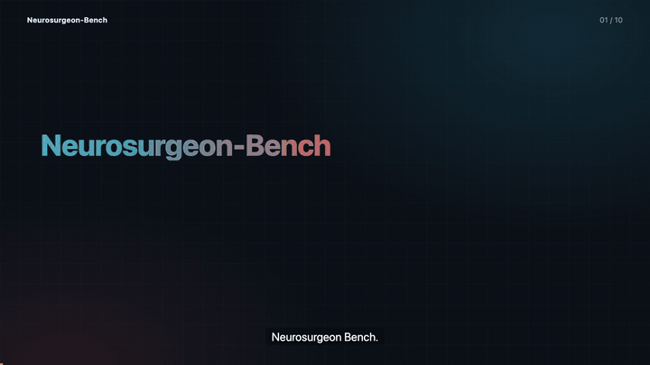
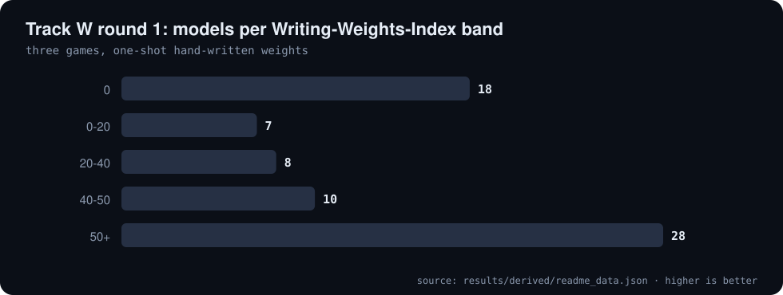
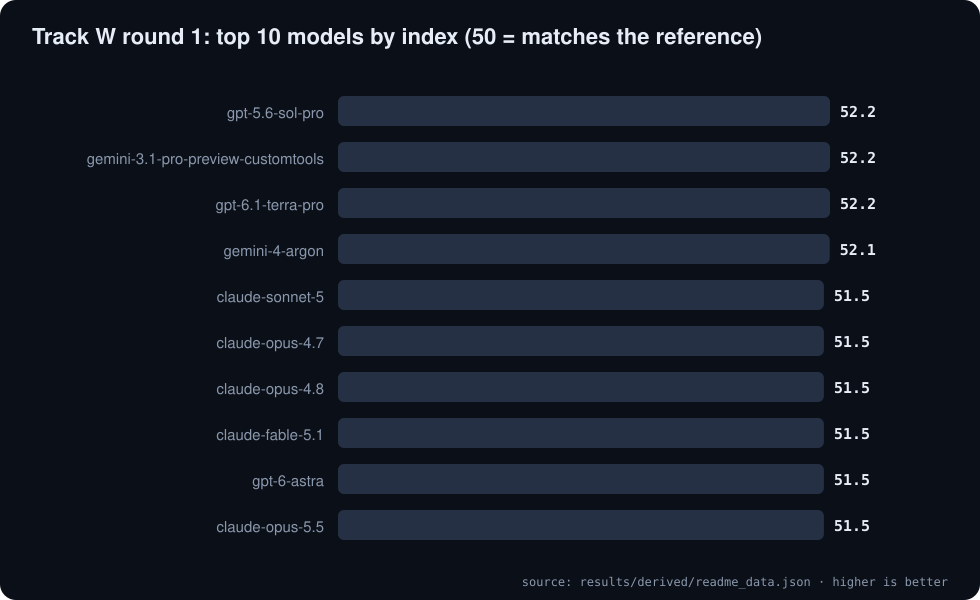
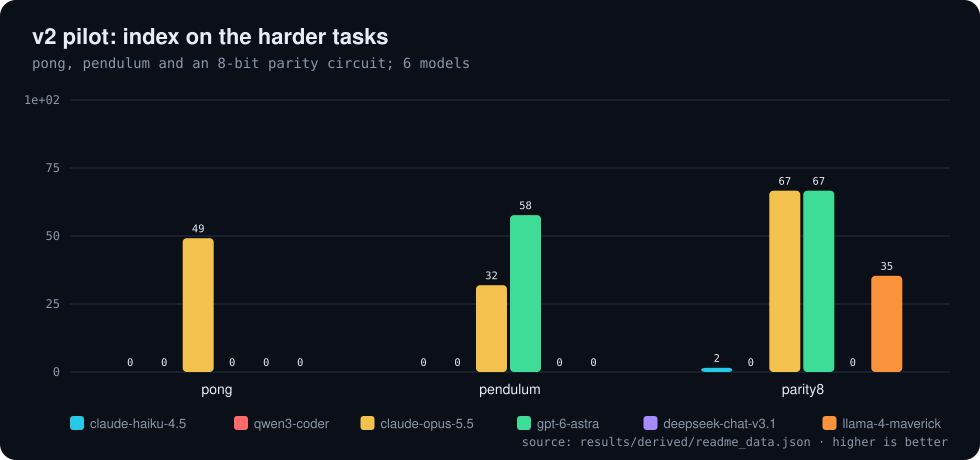
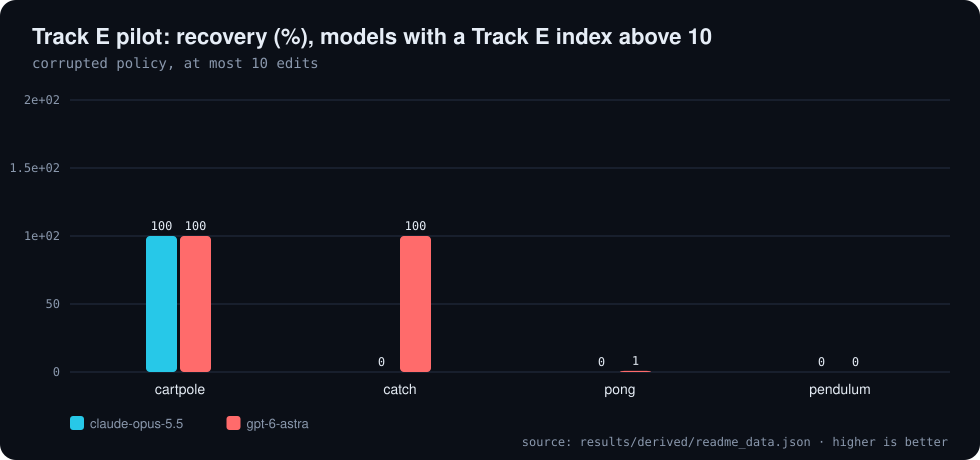
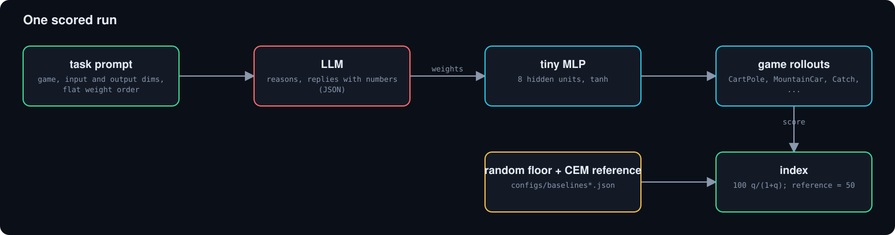

<div align="center">



# 🧠 Neurosurgeon-Bench

**Can an LLM write and edit neural-network weights directly, with no gradients and no training?**

   [](https://github.com/Bobliuuu/neurosurgeon-bench/releases/tag/v0.1.0) [](https://huggingface.co/datasets/Bobliu/neurosurgeon-bench)  [](LICENSE)

[🎬 Video](#video) · [🧪 Tracks](#tracks) · [📊 Results](#results) · [🧩 How it works](#how-it-works) · [🚀 Quickstart](#quickstart) · [⚠️ Limitations](#caveats) · [🗺️ Repo map](#repo-map)

</div>

---

**Explainer video (voice-over and subtitles): the tracks, how scoring works, and what the pilots show**

[](video/neurosurgeon_explainer.mp4)

<a id="video"></a>
Neurosurgeon-Bench asks whether a language model can **write** and **edit** neural-network weights directly: no gradient steps, no training, no code execution.
It is inspired by "Weight-Space Programming" (Writing Weights Index) and by neuron-level steering of open-weight models.
A reference policy found by CEM (not PPO, so the repo stays dependency-light) sets the 50-point mark; random weights set the floor.

> **What is measured so far.** Track W round 1 scored **71 models** on three control games and the best index is **52.2**
> (matching the reference is 50, random is 0). A pilot of the harder v2 games and of Track E is run on 6 models each. **Track S (neuron steering) has code but no result files yet.**

<a id="tracks"></a>

## 🧪 Tracks

| Track | Task | Metric |
|---|---|---|
| **W: Writing Weights** | LLM hand-writes all weights of a tiny MLP (8 hidden) for CartPole, MountainCar, Catch (v2: also Pong, Pendulum, parity8, add3, cmp3) | `Index = mean 100·q/(1+q)`, `q = max(0, score−random)/(ref−random)`; matching the reference = 50, random = 0 |
| **E: Editing Weights** | A CEM-trained policy gets 6 weights corrupted; the LLM sees the full weight vector and outputs at most 10 `[index, new_value]` edits | recovery = (edited − corrupted)/(clean − corrupted), clipped to [0, 1] |
| **S: Neuron Surgery** | LLM picks `(layer, neuron, dose)` edits to push an open-weight model toward a persona trait (`evil`, `sycophancy`, `hallucination`) | judged trait shift and coherence, against unedited and random-neuron controls |

Track S edit: at the input of `mlp.down_proj`, `act[N] += dose · median_resid_norm / ‖W_down[:,N]‖` on every token. Published edits can be replayed with `--edit L,N,dose`; `--agent MODEL` lets a model choose edits from a contrastive-probe candidate list.
Track S is a safety and interpretability measurement of how easily models can locate and exploit trait neurons. Do not deploy edited models.

<a id="results"></a>

## 📊 Results

All numbers are computed from `results/*.jsonl` and `configs/baselines_v2.json` by `tools/readme_data.py`.

**Track W round 1 (cartpole, mountaincar, catch): top 12 models by Writing Weights Index**

| model | CartPole | MountainCar | Catch | Index |
| :--- | ---: | ---: | ---: | ---: |
| openai/gpt-5.6-sol-pro | 50.2 | 55.0 | 51.3 | 52.2 |
| google/gemini-3.1-pro-preview-customtools | 50.2 | 55.0 | 51.3 | 52.2 |
| openai/gpt-6.1-terra-pro | 50.2 | 55.0 | 51.3 | 52.2 |
| google/gemini-4-argon | 50.2 | 54.9 | 51.3 | 52.1 |
| anthropic/claude-sonnet-5 | 50.2 | 53.1 | 51.3 | 51.5 |
| anthropic/claude-opus-4.7 | 50.2 | 53.0 | 51.3 | 51.5 |
| anthropic/claude-opus-4.8 | 50.2 | 53.0 | 51.3 | 51.5 |
| anthropic/claude-fable-5.1 | 50.2 | 53.0 | 51.3 | 51.5 |
| openai/gpt-6-astra | 50.2 | 53.0 | 51.3 | 51.5 |
| anthropic/claude-opus-5.5 | 50.2 | 53.0 | 51.3 | 51.5 |
| anthropic/claude-opus-5 | 50.2 | 53.0 | 51.3 | 51.5 |
| openai/gpt-5.5 | 50.2 | 53.0 | 51.3 | 51.5 |

<sub>Source: `results/derived/readme_data.json`</sub>

<p align="center"></p>

<p align="center"></p>

<details>
<summary>v2 harder games (pilot, 6 models)</summary>

Best overall index in the pilot: 54.4. Pong, pendulum and parity8 separate the models.

**Track W v2 pilot (8 tasks, 6 models): index per task**

| model | cartpole | mcar | catch | pong | pend. | parity8 | add3 | cmp3 | Index |
| :--- | ---: | ---: | ---: | ---: | ---: | ---: | ---: | ---: | ---: |
| anthropic/claude-opus-5.5 | 50 | 54 | 50 | 49 | 32 | 67 | 67 | 67 | 54.4 |
| openai/gpt-6-astra | 50 | 53 | 50 | 0 | 58 | 67 | 67 | 67 | 51.3 |
| meta-llama/llama-4-maverick | 0 | 0 | 28 | 0 | 0 | 35 | 0 | 0 | 7.9 |
| deepseek/deepseek-chat-v3.1 | 0 | 0 | 2 | 0 | 0 | 0 | 0 | 0 | 0.2 |
| anthropic/claude-haiku-4.5 | 0 | 0 | 0 | 0 | 0 | 2 | 0 | 0 | 0.2 |
| qwen/qwen3-coder | 0 | 0 | 0 | 0 | 0 | 0 | 0 | 0 | 0.0 |

<sub>Source: `results/derived/readme_data.json`</sub>

**Score floors and references (configs/baselines_v2.json)**

| task | random floor | reference (CEM / hand-built) |
| :--- | ---: | ---: |
| cartpole | 14.96 | 500.00 |
| mountaincar | -200.00 | -134.10 |
| catch | -6.23 | 10.00 |
| pong | -7.63 | 7.68 |
| pendulum | -1325.43 | -537.01 |
| parity8 | 0.50 | 0.75 |
| add3 | 0.50 | 0.75 |
| cmp3 | 0.50 | 0.75 |

<sub>Source: `results/derived/readme_data.json`</sub>

<p align="center"></p>

</details>

<details>
<summary>Track E weight editing (pilot, 6 models)</summary>

3 model-game pairs reach full recovery (cartpole and catch only); pong and pendulum are essentially not recovered. Top index 50.2.

**Track E pilot (6 corrupted weights, at most 10 edits): recovery % per game**

| model | cartpole | catch | pong | pendulum | Index |
| :--- | ---: | ---: | ---: | ---: | ---: |
| openai/gpt-6-astra | 100 | 100 | 0.8 | 0 | 50.2 |
| anthropic/claude-opus-5.5 | 100 | 0 | 0.0 | 0 | 25.0 |
| deepseek/deepseek-chat-v3.1 | 0 | 0 | 2.0 | 0 | 0.5 |
| anthropic/claude-haiku-4.5 | 0 | 0 | 0.0 | 0 | 0.0 |
| qwen/qwen3-coder | 0 | 0 | 0.0 | 0 | 0.0 |
| meta-llama/llama-4-maverick | 0 | 0 | 0.0 | 0 | 0.0 |

<sub>Source: `results/derived/readme_data.json`</sub>

<p align="center"></p>

</details>

Round 1 scored **71 models** (latest row per model); the median index is 47.3, 28 models reach 50 or more and 18 score 0.
Models with 40+ on a single game: CartPole 45, MountainCar 42, Catch 46.

<a id="how-it-works"></a>

## 🧩 How it works

The model receives the game description, the network shape (`h = tanh(W1 @ obs + b1); logits = W2 @ h + b2`, 8 hidden units) and the flat parameter order, and must answer with a single JSON list of floats.
The harness evaluates the resulting policy on fresh episodes. Providers are called through OpenRouter (`nsbench/providers.py`); token usage is recorded per model.

<p align="center"></p>

<a id="quickstart"></a>

## 🚀 Quickstart

```bash
pip install -e .            # add .[steer] for Track S
python -m nsbench.baselines # regenerate configs/baselines.json (random floor, CEM ceiling; MountainCar ref is hand-built)
export OPENROUTER_API_KEY=...
nsbench write --models configs/models.txt --rounds 1     # one-shot; --rounds 3 adds score feedback
nsbench steer --target Qwen/Qwen3-8B --trait evil --agent anthropic/claude-sonnet-4.5
python tools/readme_data.py && python3 ~/video-readme-maker/vrm.py all README.spec.yml   # this README and video
```
Results append to `results/*.jsonl`. The original short README is kept in [docs/ORIGINAL_README.md](docs/ORIGINAL_README.md).

<a id="caveats"></a>

## ⚠️ Honest caveats

- **Pilots are small.** The v2 and Track E results are 6 models with one sample each.
- **Reference is CEM, not PPO**, so index values are not comparable to the original PPO-based Writing Weights Index.
- **Track S has code but no result files yet**; nothing is claimed about neuron steering.
- **An index of 0** means no better-than-random weights were scored for that model.
- **Easy games saturate:** on CartPole, MountainCar and Catch, many models reach the reference, so the index separates little there.

<a id="repo-map"></a>

## 🗺️ Repo map

| Path | What it is |
|---|---|
| `nsbench/` | envs, baselines, the three tracks, providers, CLI |
| `configs/` | model lists, baselines (random floor, reference), Track E tasks |
| `results/` | raw jsonl outputs; results/derived is produced by tools/readme_data.py |
| `tools/readme_data.py` | derives README and video numbers from results/ |
| `README.spec.yml` | spec for video-readme-maker |
| `video/` | explainer mp4, srt, poster, preview gif (generated) |

---

<div align="center"><sub>Generated with video-readme-maker from README.spec.yml and results/.</sub></div>
